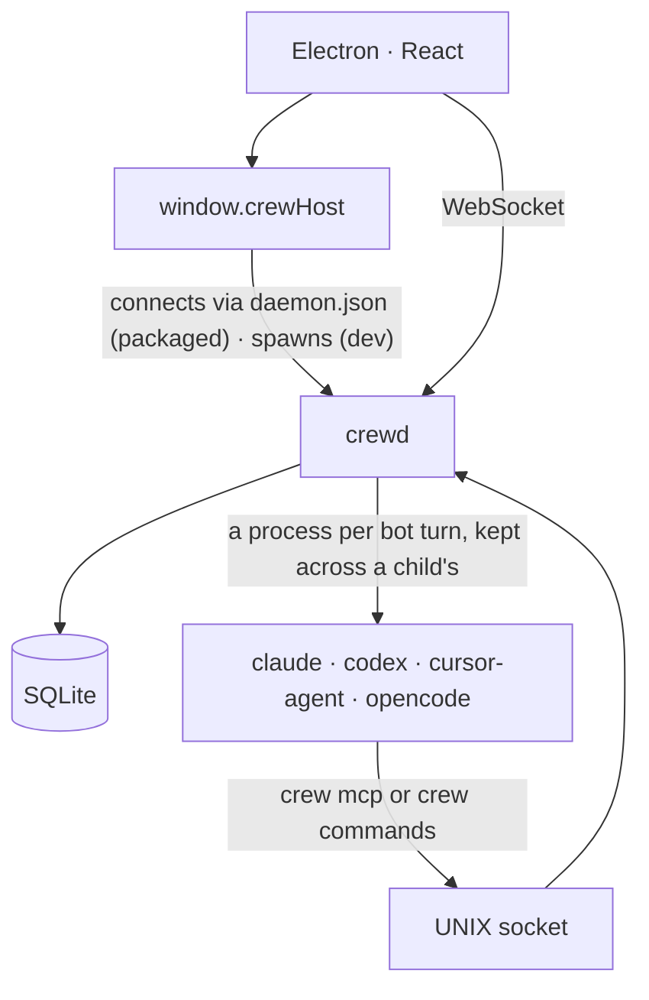
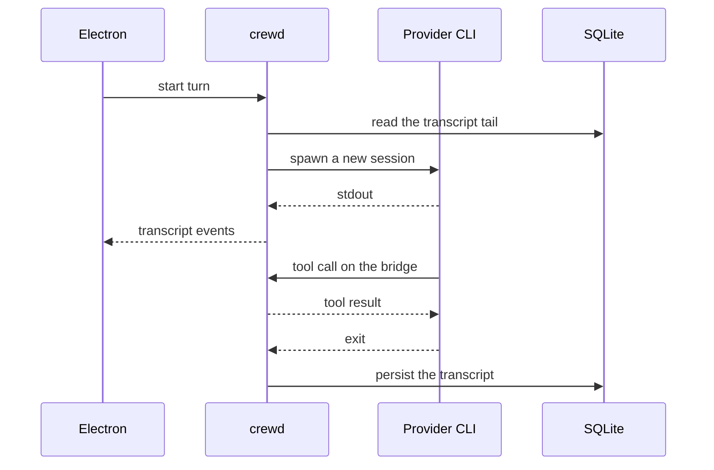
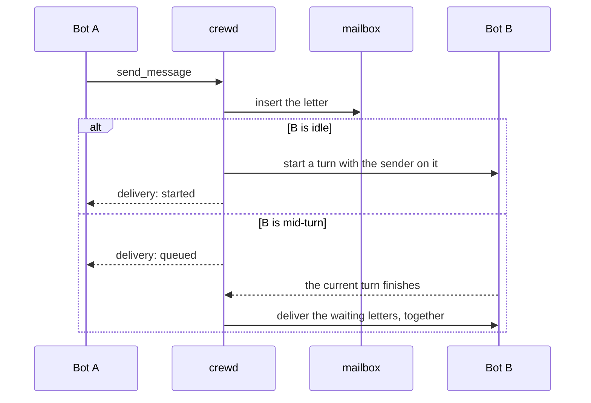

# Architecture

## The words

Models have confused these before, so they are said the same way everywhere a model reads them: here, the MCP `instructions()` and every session tool's description.

- **Bot** — a persistent identity Crew owns: a name, a description, an autonomy, a mailbox and a history. It lives in the `bots` table. `send_message` reaches it. ("Agent" is not a Crew noun: in the industry's sense, a model plus its harness, it is what Crew calls a session.)
- **Session** — one provider CLI (claude, codex, opencode, cursor) running a conversation. It lives in the `sessions` table and belongs to a bot (the session its turns run in, under the bot's own id), to whoever started it with `delegate` (a *child*, a subagent), or to the user (a *terminal*: one the user opened, or one `start_session` started).
- **Subagent** — a session started with `delegate` to do one job for the session that started it, with any provider, as a harness's own subagent would. It is nested under its parent and reports to it. Disposable.
- **Independent session** — a session started with `start_session`. It is a top-level chat session that shows in the sidebar like one the user opened, starts on the prompt it was given and reports to nobody. It is the user's. `launched_by` records which session started it and grants nothing.
- **Message** — a letter written with `send_message`. It arrives as a turn, in an envelope that names who wrote it.
- **Report** — a subagent's last message of a turn its parent started. It needs no tool.

A subagent works for the session that started it. A session works for the user.

A bot outlives its sessions; a session is one provider CLI process and can be thrown away.

Crew is two processes. Electron is the window. `crewd` is the daemon: it holds the bots, the terminals, the processes, the transcripts, and a SQLite file. The window is a client of the daemon. In the packaged app `crewd` is a LaunchAgent: closing the window leaves it running, with everything it started, and **Crew › Quit Crew and Stop Everything** stops it. In dev it is the window's child and stops with it.



```
electron/          the window; connects to crewd, or spawns it in dev
src/               the React client
crates/crewd/      the daemon process
crates/crew-cli/   the `crew` command line
crates/crew-core/  turns, store, providers, tools
crates/crew-protocol/  the messages, defined once
```

`crew-protocol` generates `src/lib/protocol.ts`. A message is defined once.

## Where `crewd` runs

**Packaged.** `crewd` runs as the LaunchAgent `rogazth.crew.crewd`, whose plist (`<data-dir>/rogazth.crew.crewd.plist`) points at the `crewd` inside the bundle with `--data-dir <userData> --supervised-by launchd` and logs to `<data-dir>/crewd.log`. `crew daemon install` writes the plist (`crates/crew-cli/src/launch_agent.rs`); the app runs that command from its bundle whenever the plist is missing or names another `crewd` or data dir, which is how a moved or replaced app takes over. `KeepAlive { SuccessfulExit: false }`: a crash brings `crewd` back, a clean stop (SIGTERM, `daemon_shutdown`) exits 0 and leaves it down. There is no `RunAtLoad`, and the plist stays out of `~/Library/LaunchAgents` because `SuccessfulExit` implies it (launchd.plist(5)) and login would load it: `crewd` runs only once Crew, or `crew daemon install|restart`, bootstraps and kickstarts it, and after a logout or reboot it stays down until Crew opens. Under launchd, `crewd` prints no handshake and does not watch stdin.

`crewd` listens for SIGTERM, SIGINT and SIGHUP before it does anything else, so a signal during startup ends in the usual cleanup and exit 0. A `crewd` that finds another one answering on the data dir's `crew.sock` leaves it alone and exits; it only replaces a socket nobody answers on. How a failed start exits is chosen for its supervisor: the app's child exits 1 and the app says why; under launchd a permanent failure (a data dir it cannot use, a database it cannot open or migrate, another daemon on the data dir) is logged and exits 0, because exit 1 would have launchd start it again every ten seconds for the rest of the session. A transient one (the WebSocket or the bridge not binding) exits 1 for launchd to retry, up to five in a row (counted in `<data-dir>/crewd.failed-starts`), then it too exits 0. The app sees no daemon come up, falls back to the child, and the child fails the same way where the app shows it. Every five minutes, and at startup, `crewd` keeps `crewd.log` at 0600 and, past 10 MB, copies its last megabyte to `crewd.log.1` and empties it in place: launchd holds an appending descriptor, which a rename would carry off with the old file.

On launch the app reads `daemon.json` and asks the bridge `whoami` with the user token (`electron/daemon-agent.ts`, decisions in `daemon-agent-plan.ts`). The plist is compared with the bundle through `realpath` on both sides, since `crew daemon install` writes the `crewd` it resolved. A daemon that answers with the app's version is used. No file, or one whose pid is dead, gets `launchctl bootstrap` if the agent is not loaded (it never is after a reboot) and then `kickstart`; the stale file is left for `crewd`, which renames its own over it. One that is alive but silent gets `kickstart -k`; one of another version, after an update, is asked to exit (`daemon/shutdown`, so its processes stop the usual way) and started again. That replacement happens only on launch, right after the plist was made to name this bundle's `crewd`. While the window is open it checks every two seconds: a new daemon (launchd's restart, `crew daemon restart`) is switched to and the window reloads; a missing one is started again; one of another version is left alone with a single notification to reopen Crew, since replacing it would only have launchd run the same `crewd` again. A quit, plain or stopping everything, stops the watchdog, and a check already in flight gives up before it reaches launchctl. The window and the browser host read the address on every reconnect, so a new port and token reach both. Quitting only lets go. If the agent cannot be installed, loaded or reached within 20 s, the app boots it out (so no second daemon shares the data dir) and runs `crewd` as its child for that launch, as in dev, with a notification that processes stop when Crew quits; the error dialog is only for when that fails too. A Crew that macOS runs from App Translocation (a quarantined app opened where it was downloaded) never installs the agent, whose path would be gone next launch: it runs the child and asks the user to move Crew to Applications. One Crew runs per data dir (`requestSingleInstanceLock`); a second one focuses the first.

**Dev** (`npm run app`, worktrees with their own `CREW_DATA_DIR`). Electron spawns `crewd --data-dir <userData>`, reads the handshake line on stdout, and `crewd` exits when its stdin closes or on a signal. A daemon that dies is started once more, or again if it had been up over a minute.

`daemon_shutdown` over the WebSocket, and `daemon/shutdown` on the bridge for the user's token only, ask `crewd` to stop exactly as a signal would: it removes `daemon.json`, gives supervised processes one stop grace and exits 0.

## A turn

A turn is one run of the provider CLI. A bot's turn starts a clean provider session; the daemon hands it the tail of the conversation, streams the output back to the window, and writes the transcript when the process exits. A child's turn carries on its own provider session instead, on a process kept between its turns (see below).



Each provider is a module under `crates/crew-core/src/providers/`. It knows how to spawn that CLI and how to read its stream.

## Sessions a caller starts

Any bot, terminal or the user can hand a job to another provider CLI and get its answer back, without that CLI needing a tool to answer: its last message of each turn is its report. `delegate` starts it; a bot parent is woken by the report, a terminal session (in either view: nothing starts a turn in it for a report yet) reads it with `read_session` or blocks on it with `wait: true`. A report goes to whoever started the turn: a turn the parent started (the first prompt, a message) reports to the parent, and a turn the user started by writing in the subagent's tab reports only to the user (`note_starter` in `turns.rs`).

```mermaid
sequenceDiagram
  participant P as Parent (bot, terminal, user)
  participant D as crewd
  participant C as Child CLI

  P->>D: delegate { prompt, provider?, worktree?, wait? }
  D->>C: first turn (a fresh provider session)
  C-->>D: stream; the process stays up
  D->>D: "Turn ended" block, event at its position
  alt wait: true
    D-->>P: { status: reported, report }
  else a bot parent
    D->>P: a turn opening "## Report from session …"
  end
  P->>D: send_message { to: child, text }
  D->>C: next turn, on the same process
```

A child is driven by the same `TurnHost` a bot is, with three differences (`crates/crew-core/src/session_tools.rs`, `turns.rs`): it resumes its provider's conversation (`claude --resume`, Codex's `thread/resume`, `opencode run --session`, Cursor's `session/load`) where a bot is handed the tail; its process stays up between its turns; its persona is the envelope — who started it, and that its final message is its report; and the end of each of its turns is an event. Every event appends a block to its transcript, so the event's position there is a cursor no other event shares: `read_session` counts in the same numbers, and Crew keeps what the owner last saw.

A child's Claude or Codex process, and a chat session's, outlives its turn (`keeps_process`, `park`, `release` in `turns.rs`): the next turn is the next stream-json user message on the same stdin, or the next `turn/start` on the same app-server thread, so a second message does not restart the CLI and its MCP servers, and the bridge token is minted once per process. What a turn leaves running in the background outlives it with the process. A Claude turn of the user's ends at its `result`; a child's waits for its background work up to `BACKGROUND_GRACE` (its report is the last thing it says), and then ends too. When that work reports, or a steer the turn never read is still queued in it, the CLI starts a turn by itself (`system/init` with no turn of Crew's running): Crew takes it as a turn nobody sent (`adopt_claude_turn`), with the session working, its events in the transcript and its end settled like any other, and what is sent meanwhile steers or queues as into any running turn. A turn of Crew's whose message has not gone in yet when that happens takes the CLI's turn over instead of starting a second. Esc stops the turn only (`cancel`): Claude is sent `interrupt` with `cancel_queued`, never `stop_task`, and `initialize` declares `perTaskStopAffordance` so that the interrupt spares the background work, which the panel stops one task at a time; a turn held on its background work has nothing to interrupt and just ends. The stopped process is kept, and the next turn first waits for the interrupt's own `result`, which would otherwise end it; a CLI that does not answer within `INTERRUPT_GRACE` is let go. Codex closes an interrupted turn with `turn/completed` and keeps its background terminals (its TUI stops them with `/stop`), so a stop it closed keeps the app server too. The process is let go, and the next message resumes the conversation by its provider id, when a turn fails, when the child exits, and after 30 minutes with no turn (`release_idle`, beside the reaper), stretched to 4 hours while background work or a live child of its own pins it. A change of model, effort, autonomy or speed between turns is applied in place where the CLI takes it (Claude's `set_model`, `set_permission_mode` and `apply_flag_settings` control requests; Codex's overrides on `turn/start`), and otherwise relaunches on the same conversation. Live readings such as the context meter (`context.updated`) reach the windows through `TranscriptHub::emit_live` and are never written to the transcript.

A terminal session the user opens is either a chat or a terminal, fixed when it is created from the "New sessions open in" setting (`sessions.view`; nothing switches it later). A terminal-view session is the CLI's own screen in a PTY, and Crew only reads its history. A chat-view session is driven by the same `TurnHost` as a child (`driven()` in `turns.rs` says which sessions Crew drives and how): it carries on its provider's own conversation (Claude names it by the session's id, so `--session-id` the first time and `--resume` once its file exists), its process is kept like a child's, and it runs as the user's own CLI: no persona, the user's settings, and what the user types reaches the model as typed, with no envelope. Nobody waits on its turns, so they settle as a bot's do, with no event and no report.

A message the user sends to a child or a chat session while its turn runs is a letter from the user. Into a Claude or Codex turn it is a steer, claimed at once and delivered when the CLI echoes it (a steer the turn ended without reading goes back to waiting); elsewhere, or when the user asks to wait (⌘↵), it waits in the box, and everything waiting goes as one turn when the running one ends, in the user's order (`queue_order`, else arrival). The window shows the user's waiting letters as chips over the composer and lets them be edited, reordered, dropped or sent now (`mailbox_edit`, `mailbox_reorder`, `mailbox_dispose`, `turn_send_now`, which stops the turn and starts the next with that letter first). A stop holds the queue until the user's next message.

A parent that has turns (a bot, or a top-level session in the chat view) finds each report in its mailbox as a `report` letter, which wakes it (`TurnHost::wake`). Letters from sessions wait 2 s for the next and never more than 10 s from the first, then go as one turn, or as one steer into a running Claude, Codex or opencode turn (reports, questions and approvals only; a plain message waits for the turn's end unless `steer: true`; Cursor queues). A question or an approval does not wait, and neither does anything the user wrote. A parent in the terminal view gets no letter: it reads with `read_session` or `wait`. A letter stays claimed, not delivered, until the provider confirms it read it (Claude's replayed user message, Codex's `turn/started`, the prompt accepted by opencode or sent to Cursor); a daemon that stops first puts it back (`release_unfinished`) and the startup sweep (`deliver_waiting`, top-level sessions included) hands it over. A turn that fails before that gives the letters back and holds the session until the user writes or a new letter arrives. A session or a bot pauses after 20 turns in a row that letters started: the count is kept in `app_state` (`auto_turns:<id>`), letters keep landing without waking it, the chat bar shows "Paused after 20 automatic turns" (`paused` on the session), and the user's next message resets it. A report the parent already read (with `read_session`, or as the answer of `start_session`'s `wait`) is taken back out, so it never arrives twice. `wait` blocks 600 s by default and 3600 at most; on timeout the child carries on and its report wakes the bot later. A child that stops on a question (Claude's `AskUserQuestion`, Codex's user-input request, Cursor's `ask_question`) wakes its bot parent with a `question` letter, ends a `wait` early, and is answered by `send_message` to it (`text` for one question, `answers` for several); the user can answer the same card in the window, and whichever comes second is told it was already answered (`TurnHost::answer` is the one door). An approval is the user's alone: it wakes nobody, and `list_peers` shows the child as `waiting_for_user`.

`start_session` starts an independent session: a top-level session in the chat view (fixed at creation; kind `terminal`, view `chat`, in a new worktree if asked), nobody's child, with `launched_by` set. Its first prompt is a turn started at once, in an envelope that names the launcher. It reports to nobody, so `wait` is refused, is never reaped, and counts against no cap. `delegate` and `start_session` replaced `start_session`'s `owner`, which is refused.

`start_sessions` starts 1–20 independent sessions in one call, each entry (`prompt`, `provider`, `model`, `worktree`, `name`, `autonomy`) made on its own through the same `make_session` as `start_session`: the result lists every entry with `ok`, and a worktree made for an entry that then failed is kept and named in its result. More than 20 is refused whole, before anything starts. `delegate`, `start_session` and `start_sessions` take an optional `request_id`: the first call's result is stored per caller (`requests.rs`, table `start_requests`, migration 35, kept 7 days) and a retry with the same id from the same caller gets it back with `repeated: true` instead of starting anything (a retry of `delegate` with `wait` waits for the first call's subagent). An id names one tool, and a call that failed stores nothing.

Controlling sessions: `interrupt_session` is `TurnHost::stop`, the Esc of the chat (each provider's own interrupt), allowed for whoever `may_write`; with `text` the letter is put first in the box and `TurnHost::interrupt_with` hands the queue over when the stopped turn ends, as Send now does. `update_session` renames (the starter, or whoever may write) or deletes (the starter, meaning the parent or `launched_by`, and the user); there is no archive (migration 37 dropped the column migration 36 had added). Delete removes the rows, and so the transcript, of the session and its subagents but never a worktree, and refuses while a worktree they work in has uncommitted changes (`git status` entries from `worktree::list`). The daemon's part (the terminal, the token, the browser tabs, and telling every window with `sessions-deleted`) is the `Retirement` it installs. `stop_session` ends the subagents below a subagent first, deepest first, and leaves independent sessions it launched alone. `read_session` reads any session or bot in the workspace; only the parent's reads advance `seen` (`is_owner`). A session in the terminal view has no Crew transcript, so its blocks come from its provider's own history through the `HistoryReader` the daemon installs (`SessionWatch::read_blocks`); if the history cannot be found the call says so and there is nothing to read. `list_peers` gives each entry a `type` (bot, subagent, session), `launched_by`, and `write` by the reach rule.

The limits: a subagent cannot `delegate` (depth one: it is told to do the job itself or ask its parent) but may `start_session`; a parent has at most four live subagents; a subagent's autonomy is the parent's or lower; only the parent, or the user, stops (`stop_session`) or decides an approval of a subagent. A subagent that has exited stays exited: `send_message` to it answers that another is started with `delegate`. Idle children exit after 30 minutes, and their process goes with them. A child caught mid-turn by a restart of `crewd` carries on when it comes back. The window lists a child under whoever started it, and opens it as Crew's chat.

## Writing to each other

`send_message` writes to any bot or session in the workspace except the caller itself and an exited subagent. A letter to a session in the terminal view waits in its mailbox for the user (`delivery: waiting_for_user`); one to an exited independent session resumes it on its conversation (`delivery: resumed`). A subagent may always write to its own parent, whatever the autonomy. The one rule is that the target's autonomy may not be higher than the caller's; the user is exempt. Whoever may write to a subagent waiting on a question may answer it; an approval is decided only by the parent or the user. The letter goes in the reader's mailbox; the daemon hands it over as a turn with the sender on it. One envelope text serves a turn and a steer (`mailbox::envelope`): `## Message`, `From: <name> (<kind> <id>), a model` (or the user, a person), how to reply with `send_message` to that id, and that no reply is needed. The prompts say that text is from another session, not the user. If the reader is busy, the letter waits until the current turn ends; `steer: true` writes it into the running turn instead where the CLI takes that (Claude, whose `--replay-user-messages` echo says when; Codex's `turn/steer`), and queues it anywhere else. The answer says how it went: `delivery: started | queued | steered | answered | resumed | waiting_for_user`.



Claude, Codex, opencode and Cursor (over ACP) reach Crew through an MCP server (`crewd --mcp`) whose `tools/list` is every tool the caller's kind may call, each with its schema. The model sees them in its own tool list under the name its harness gives them (`mcp__crew__send_message` for Claude and Codex, `crew_send_message` for opencode, `send_message` on server `crew` for Cursor), and the prompt Crew hands a bot or a child names them the same way, built from the same list. For the sessions Crew drives, Crew's tools are pre-approved and never deferred (Claude's `--settings` allows `mcp__crew__*` and its `--mcp-config` marks the server `alwaysLoad`, Codex's server config approves them, opencode's inline config allows `crew_*`, Cursor's requests are answered at once) and a call may run 65 minutes. Transcripts from before still hold calls to the old `find_tool`/`call_tool` gateway; the chat reads such a `call_tool` row as the tool it named. People reach the same bridge with `crew` commands in the shell (`crew send <id> <text>`, `crew peers`), found with `crew --help`.

## Who is calling

The bridge is a UNIX socket in the data dir. Every request carries a token, and the token alone says who is calling (`crates/crew-core/src/caller.rs`):

- **A bot.** A token per session, minted when a turn starts and retired by the next one.
- **A terminal session** in the terminal view. `pty_spawn` with `session` has the daemon complete the argv the window built: the provider's MCP flag (Claude's `--mcp-config` is added to the user's own servers, not in place of them) and `CREW_SOCKET`/`CREW_TOKEN` in the environment. The token belongs to that one process and is handed back when it is reaped. A terminal has no turns, so nothing can wake it: letters to it wait in its mailbox for the user, and a letter it sends tells the bot that no reply can reach it. Its terminal is keyed by the session (`<workspace>/session:<id>`), not by the tab: closing the tab sends `pty_detach`, and the CLI runs on, draining into the ring without waiting for a viewer's credit, until a tab opened again attaches to it (`pty_spawn` with `reuse`). `session_stop` ends it, and so does deleting the session, its worktree or its workspace; `sessions_running` tells a reloaded window which are still up.
- **opencode's shared server.** One `opencode serve` runs for the daemon, with an MCP server per folder, so no token can be per session. The server gets a host token (`OpencodeHost::start_run`, in `bridge.rs`) that may list tools and nothing else. opencode puts the calling session in the `_meta["ai.opencode/sessionID"]` of each `tools/call`, `crewd --mcp` forwards it, and the bridge believes it only with the host token and only for an id the driver bound (`bind`) on that server run: the call is then that Crew session's, with its kind, workspace and autonomy. An unbound, foreign-run or missing id is refused. Every session in a folder sees the same list, the union of what each kind may call, and a tool outside the caller's kind is refused at call time ("This session cannot use …"). Each binding also yields a token for that session's shell (`CREW_TOKEN`, through opencode's `PUT /session/:id/environment`), retired with `unbind` or `end_run`. The host token belongs in the MCP server's own environment, never the shell's.
- **The user.** `<data-dir>/daemon.json` (0600) holds the WebSocket `url` and `token`, the bridge `socket`, a `userToken` and the `version`. It is written when the daemon starts and removed when it stops cleanly. A call with the user token names its workspace with `workspace`, an id or a path inside it. This is what the `crew` CLI reads.

This is policy, not isolation. Every process Crew starts, bots and terminals included, runs as the user's UID and can read `daemon.json`, whose `userToken` speaks as the user (no process approval, `daemon/shutdown`) and whose WebSocket `token` has every power the window has. The 0600 mode keeps it from other users, not from sessions. What keeps a session to its own identity is that the tools it is handed use its own token: `crew` inside a session never falls back to `daemon.json`, and a process that goes and reads the file itself is not stopped.

`tools/list` and every tool answer according to the caller. The `initialize` of `crewd --mcp` carries `instructions` saying who the caller is to Crew and what its tool families are for, so a terminal session learns that without Crew touching its prompt. A family of tools that lives in its own module implements `ToolFamily` and is registered on the `Toolbox` in `crewd::serve`.

## The `crew` command

`crew` (`crates/crew-cli`) is a client of the same bridge. Inside a session (`CREW_SOCKET` or `CREW_TOKEN` set) it takes them and is that session: `--data-dir` does not change that, half a session is refused rather than taken for the user, and `crew daemon` is refused outright, since the daemon runs every session. Only `--as-user`, meant for a human typing at a Crew terminal, makes it the user there. Anywhere else it reads `daemon.json` from `--data-dir`, `$CREW_DATA_DIR` or the installed app's folder, and speaks as the user in the workspace holding the current directory. Its commands are `crew <group> <verb>` (bots, messages, routines, processes, tabs). Each tool declares its own group and verb in its definition (`Tool.cli`), one per action for a tool that merges several (`control_process` is `processes start|stop|restart|pause|resume`), and `crates/crew-cli/src/commands.rs` builds the tree from those and from the tool's schema, so the CLI and MCP cannot drift apart: a test fails if a tool has no command. A few are written by hand where a shell wants more than the tool (`processes logs -f`, `bots send <name>`). The bridge answers two methods for it beside `tools/*`: `tools/catalog`, every tool the caller may run; and `whoami`, for `crew status`. `crew mcp` is the stdio server; `crewd --mcp` stays one version as an alias. The app bundles `crew` next to `crewd`, and **Settings › General › Command line** links it onto the user's PATH. A Linux machine gets `crewd` alone, with `crew` a symlink to it: `crewd` run under that name is the CLI, so the `crew` beside `crewd` that a Cursor session is told to run is there too. When the LaunchAgent serves the data dir, `crew daemon stop` asks for `daemon/shutdown`, `restart` is `launchctl kickstart -k` and `status` adds what `launchctl print` says; otherwise they go through the pid in `daemon.json`. `crew daemon install|uninstall` write or remove the plist and bootstrap or boot it out.

## Files

`crewd` answers every question about a worktree's files, so they work the same on a remote machine. ⌘P matches in memory against one list per worktree (`list_project_files`, `crates/crew-core/src/files.rs`): what `git ls-files` tracks or has not seen yet, plus what the repo ignores when it is small. `git ls-files -oi --directory` names each ignored folder without going in; the shallow ones are walked first, each dropped whole past 1,000 files and all of them together stopping at 2,000, so `.ai/` or a `.env` is there and a build, a cache or an upload folder is not. Loose ignored files count by the folder they sit in, and more than 20 there are generated. `node_modules`, `vendor`, `target` and the like are never looked at. Outside a repo the list walks the folder with `.gitignore` rules, and nested repos list their own files through git.

The explorer (⌘⇧E, `src/chrome/explorer`) does not use that list: it reads one folder at a time from disk as it opens (`list_folder`), everything included, with what git ignores dimmed by one `git check-ignore` per folder. The folders on screen are listed again every three seconds while the window has focus, since agents write files all the time. Rows are virtualised, so opening `node_modules` costs what the pane shows.

⌘⇧F (`search_files`, `crates/crew-core/src/file_search.rs`) searches the same files ⌘P lists, with no cap, using ripgrep's own searcher and regex engine. Four threads read the files: on macOS more of them slow each other down in `open`, and ripgrep with `-j12` is slower than with `-j4` too. A search stops at 10,000 matches, skips binaries and files over 8 MB, and gives up as soon as a newer search starts in the same folder. A result opens its file with the match selected (`src/lib/reveal.ts`).

## Notifications

Every notification goes through `dispatchNotification` (`src/lib/notifications.ts`), which shows it or answers why not: notifications off, do not disturb, the kind switched off, the session's own switch off, the window focused on that very session, or the same news within five seconds (keyed by session, so a CLI that rings and then stops to ask is one notification). Its sources are the status and harness events of the chats Crew drives, in `turnRuntime.ts` (a question, a permission prompt, a letter from a bot), terminal sessions' tracker and bells, OSC 9 and 777 included (`useSessionActivity`), a CLI's hooks reporting a new ask (`Terminals.tsx`), a command that exits with an error or that auto-restart gave up on (`processAlerts.ts`), and a remote machine dropping or coming back. Each kind has a banner switch and a sound in **Settings › Notifications**, kept in the daemon's state as `notifications:prefs`. Crew in the background gets a native banner; in front, a toast with Open (`chrome/Toaster.tsx`). The window plays the sound itself (`notificationSound.ts`, bundled WAVs made by `scripts/sounds.mjs`, or a file the user picked, which main reads) and keeps the banner silent, unless the sound is the system's. Main (`electron/notifications.ts`) holds each banner until it is clicked, which brings the window up and sends the target back so the window opens that session, switching workspace first if it must; a banner that fails to show is the sign macOS has Crew's notifications off, and Settings links to System Settings. The Dock badge counts sessions that started waiting while Crew was in the background and clears when it comes forward (`notificationBadge.ts`).

## A machine that is not this Mac

The window keeps one connection per daemon, and a call goes to the daemon that owns its workspace, session, or path (`src/lib/client/route.ts`). A connection is online once the daemon says hello; a remote that does not answer is offline in a few seconds, and its workspaces stay on the rail from the last list it gave. This Mac's daemon stores the address book (`remote_list`) and every preference. The token that opens a remote daemon stays in the keychain, not in that database. Workspaces, sessions, files, and terminals follow the daemon that owns them. Routines armed on a remote daemon keep firing when the Mac is asleep or off, because the scheduler lives in `crewd`.

`crewd serve` listens on the machine's Tailscale address. The Mac installs that binary over SSH, as a systemd user service, and pairs with the token the daemon writes under `~/.crew`. Removing a machine stops the service. `~/.crew` stays unless the confirm says to delete it. Linger is left as it was. Every CLI and every build it runs lives in the unit's cgroup, so the unit has `OOMPolicy=continue`: the kernel killing one of them for memory ends that process, not the unit and every session in it.

A session left working while the Mac sleeps or Crew is closed keeps running. A terminal holds its child to the window's credit only while a window is attached: once the last one goes, what the child writes fills the ring and nothing waits on acks. A Mac that sleeps never closes its socket, so `crewd` sets keepalive and a 60-second user timeout on each one and gives up a window that answers nothing. When `crewd` itself goes down (an update, a crash) its terminals go with it, and it announces no exit for them: the window, once the daemon answers again, finds nothing under the pane's id and starts the session's CLI again on its conversation, as it does when Crew opens (`onLost`, `src/lib/pty.ts`). Each provider process `crewd` starts runs in its own process group, and the group is killed (SIGTERM, then SIGKILL after 2 s) once its leader is reaped, so a helper the leader left behind (cursor-agent's `worker-server`, an `npm exec` child, a backgrounded job) does not outlive it. The live groups are kept in `<data-dir>/agent-groups.json`, and at startup `crewd` kills what a crash or a SIGKILL left of them, but only those it can tell are still its own: the file must be from the same boot, and a group whose leader is alive must have the start time recorded for it, since a pid can be reused once its group is gone.

Every page shares one session (`persist:crew-browser`), whatever its workspace, so the app signs in once; incognito pages share one in-memory session. A remote workspace's browser reaches `localhost` on that machine at the machine's alias: `localhost:3000` becomes `<alias>.localhost:3000`, the alias being the machine's name as a DNS label (`src/lib/browser/machines.ts`). The window rewrites what it opens, and main redirects a remote page's main-frame loopback the same way. While any machine is known, the session sends its loopback to a relay on this Mac (`electron/browser/remote-proxy.ts`), which dials `<alias>.localhost` through that machine's SOCKS5 proxy on the next port and everything else from here. A plain-HTTP request a remote page's code aims at plain `localhost` keeps its URL and names its machine in `x-crew-machine`, which main sets and the relay strips. The proxy only connects to loopback. Browser tools reach the Mac's pages through the browser host registered with the Mac's own daemon; a remote `crewd` has no host, so an agent there is told to open Crew.
