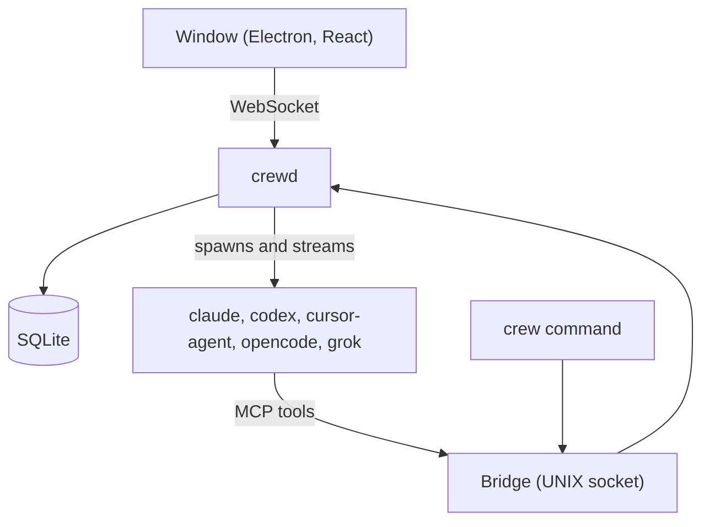
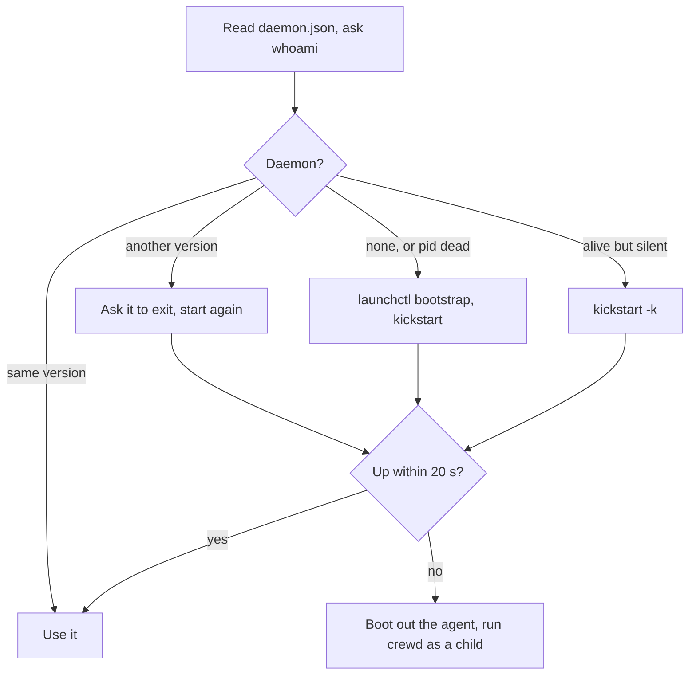
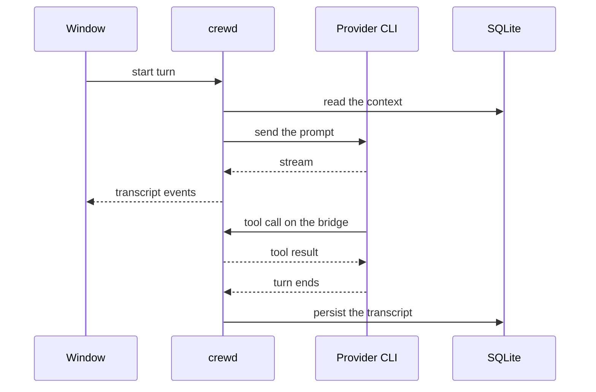
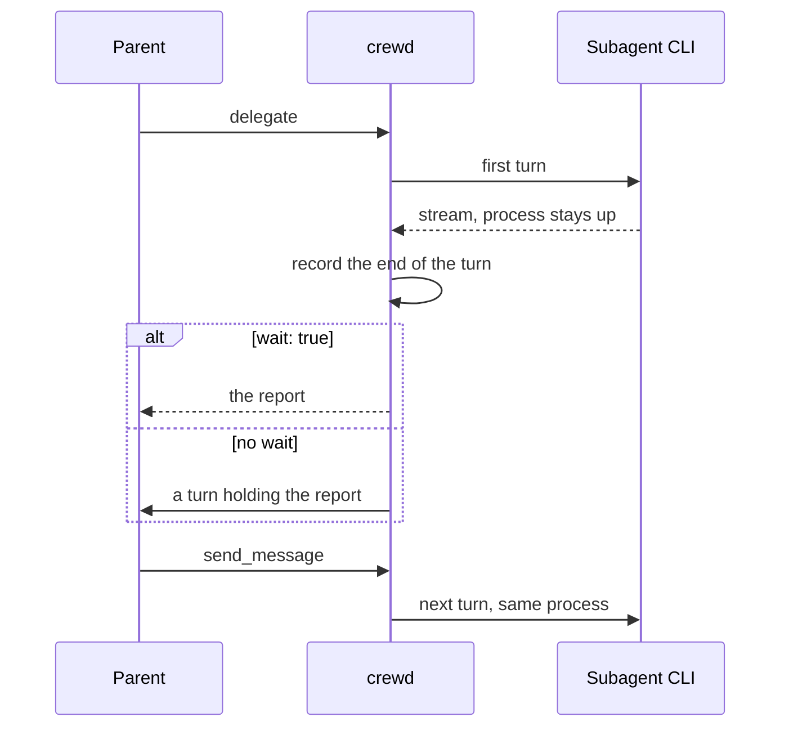
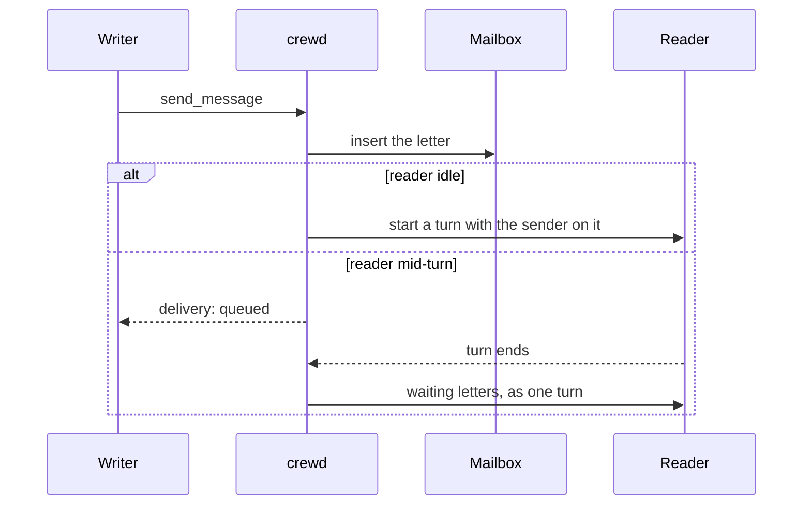
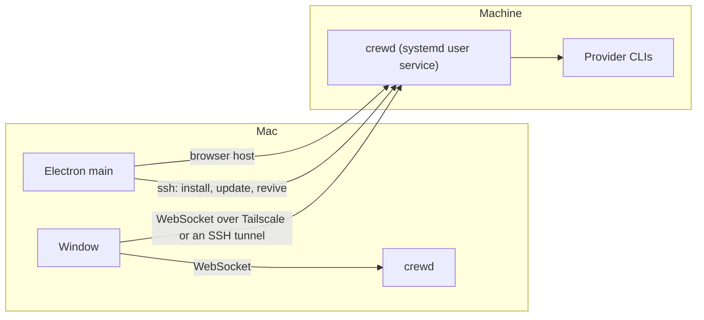

# Architecture

Crew is two processes. Electron is the window. `crewd` is the daemon: it holds the bots, sessions, terminals, processes, transcripts and a SQLite file. The window is only a client, so sessions keep running when it closes.



```
electron/              the window; connects to crewd, or spawns it in dev
src/                   the React client
crates/crewd/          the daemon process
crates/crew-cli/       the `crew` command line
crates/crew-core/      turns, store, providers, tools
crates/crew-protocol/  the messages; generates src/lib/protocol.ts
```

## The words

These are said the same way here, in the MCP `instructions()` and in every session tool's description.

- **Bot**: a persistent identity with a name, a description, an autonomy, a mailbox and a history. It outlives its sessions.
- **Session**: one provider CLI running a conversation, driven over the provider's protocol. It belongs to a bot, to the session that started it, or to the user.
- **Subagent**: a session started with `delegate` to do one job for its parent. Nested, disposable, reports to its parent.
- **Independent session**: a session started with `start_session`. It belongs to the user and reports to nobody. `launched_by` records who started it and grants nothing.
- **Message**: a letter written with `send_message`. It arrives as a turn, in an envelope naming the writer.
- **Report**: a subagent's last message of a turn its parent started. It needs no tool.

The window adds four, which the daemon does not use:

- **Agent**: anything with its own transcript that a session started: a native subagent, a Crew subagent or an independent session.
- **Work**: everything a session started that runs beside its turn: agents, shells, monitors and processes.
- **Thread**: one agent's full transcript, opened over its parent's chat.
- **Conversation**: the letters between two bots.

## Where `crewd` runs

Packaged, `crewd` is the LaunchAgent `rogazth.crew.crewd`: closing the window leaves it running, a crash restarts it, and **Crew › Quit Crew and Stop Everything** stops it. It does not start at login, only when Crew or `crew daemon` starts it.

In dev, it is the window's child and stops with it. Linux machines run it as a systemd user service (see [Remote machines](#remote-machines)).

On launch, the packaged app decides from `daemon.json` and a `whoami` on the bridge:



While open, the window checks every two seconds and follows a restarted daemon. One Crew and one `crewd` run per data dir.

## Environments

The data dir is the environment: installed app, dev build, linked checkout, e2e sandbox and remote build each have their own, and Crew writes nothing of its own outside it (`crates/crew-core/src/paths.rs`). It holds the database, socket, logs, `trace/`, media and `tmp/`. The work dir holds what the user works in: worktrees and, by default, the Home workspace's folder. `layout.json` in the data dir says where the work dir is. Every process Crew starts gets `CREW_DATA_DIR`, so `crew` reaches the daemon that started it. The provider CLIs' own state (`~/.claude`, `~/.codex`, ...) stays theirs.

## A turn

A turn is one run of a provider conversation. Each provider is a module in `crates/crew-core/src/providers/` that knows how to spawn its CLI and read its stream.



All sessions go through `TurnHost` (`crates/crew-core/src/turns.rs`). They differ in what they start from:

| | Starts from | Prompt | Process between turns |
|---|---|---|---|
| Bot | its episode's provider session, or a clean one when the episode is cut | a new session: description, rules, folder, conversation tail; a carried one: the turn's header | kept while its cache is warm |
| Subagent | its own provider conversation | an envelope naming its parent | kept |
| User's session | its own provider conversation | none: runs as the user's CLI | kept |

A kept process is released after a failed turn or 30 idle minutes, and the next message resumes the conversation by its provider id.

### A bot's episode

A bot carries one provider session on, an episode, while that costs less than starting another (`crates/crew-core/src/bot_episode.rs`). Before each turn Crew decides:

| Before the turn | Then |
|---|---|
| no episode, the last turn failed, or the model, effort, folder or persona changed | cut |
| context past the cap (150k tokens, or 60% of a smaller window) | cut |
| idle less than the cache's window | carry on |
| idle past the window, under 50k tokens of context | carry on: writing it again costs about a new session's prefix |
| otherwise | cut |

A cut lets go of the provider session and its process, says why in the chat, and the turn starts a clean session with the tail, as every bot turn once did. Crew never lets a provider compact a bot: the cap is under every provider's own threshold, which stays as a safety net for a turn that grows past it.

The window is how long the provider keeps its prompt cache after the last request, less a minute:

| Provider | Window |
|---|---|
| Claude | the lifetime its last write was given (`ephemeral_5m` or `ephemeral_1h`); bots ask for an hour (`CLAUDE_CODE_PROMPT_CACHE_TTL=1h`) |
| Codex | 25 minutes on GPT-5.6 and later (OpenAI keeps a prefix at least 30), else 4 |
| Grok, opencode | learned, from 4 minutes |
| Cursor | what the model's maker documents: it reports no cache |

A learned window grows when a small episode carried on past it finds its cache still warm, and shrinks when one carried on within it finds the cache gone (`cache_windows` in the store). A bot's idle process goes when its window closes.

## Sessions a caller starts

`delegate` starts a subagent. Its report wakes the parent, or answers a `wait: true`. A subagent stopped on a question or an approval wakes its parent too, and notifies nobody else. The parent allows only what its own autonomy covers; past that it denies, or passes it to the user with `ask_user`, who decides on the subagent's card in Crew, so a parent cannot allow anything by claiming the user agreed.



Limits: subagents work at depth one, a parent has at most four live, and a subagent's autonomy is at most its parent's. Idle subagents exit after 30 minutes and stay exited.

## Writing to each other

`send_message` writes to any bot or session in the workspace whose autonomy is not higher than the caller's. The user is exempt, and a subagent may always write to its parent.



`steer: true` writes into the running turn where the CLI allows it. A letter stays claimed until the provider confirms it read it, so one a stopped daemon never delivered goes back in the box. A session pauses after 20 turns in a row started by letters, until the user writes.

## Who is calling

Every bridge request carries a token, and the token alone says who is calling (`crates/crew-core/src/caller.rs`):

- **A bot or session**: a token minted for its process or turn.
- **opencode**: one shared server, so a host token that can only list tools. The bridge takes the session id opencode puts on each call, and only for ids Crew bound on that run.
- **The user**: `userToken` in `<data-dir>/daemon.json` (0600), which the `crew` command reads.

This is policy, not isolation. Everything Crew starts runs under the user's UID and could read `daemon.json`. A session keeps its identity because its tools use its own token, and `crew` inside a session never falls back to the file.

Tools reach models through an MCP server (`crew mcp`), and each answers according to the caller. The `crew` command is a client of the same bridge: each tool declares its command in `Tool.cli`, and `crates/crew-cli/src/commands.rs` builds the tree from those, so the CLI and MCP cannot drift apart.

## Tracing

A bug seen yesterday is diagnosed from files. `<data>/trace/` holds JSON lines from the daemon and the window: `crewd.ndjson`, `errors.ndjson` (WARN and up, which outlive the main file's rotation) and `app.ndjson`. `crew trace` merges and filters them without the daemon, so it works while `crewd` is stalled or stopped.

Traces hold ids, kinds, names, durations, sizes and sanitized error text. They never hold prompts, replies, tool arguments or results, terminal input or output, file contents, tokens or env values; a test fails if a marker reaches them.

To add a line, name it `domain.action` with `tracing` (or `trace.info` in the window), and put ids and counts in fields. `eprintln!` is forbidden in `crates/` by clippy: a closed stderr would panic the daemon.

## Files

`crewd` answers every question about a worktree's files, so they work the same on a remote machine.

- **⌘P** matches in memory against one list per worktree (`crates/crew-core/src/files.rs`): what git tracks or has not seen, plus small ignored folders.
- **⌘⇧E** reads one folder at a time from disk, everything included (`src/chrome/explorer`).
- **⌘⇧F** searches the ⌘P files with ripgrep's engine (`crates/crew-core/src/file_search.rs`).

## Settings

A setting is a `defineSetting` listed in `src/lib/settingsEngine/defs.ts` and read with `useSetting`. Its scope is `global` (every daemon), `env` (one machine) or `device` (this computer). Daemons do not talk to each other, so the window carries global settings between them, and the newest revision wins.

## Notifications

Every notification goes through `dispatchNotification` (`src/lib/notifications.ts`), which shows it or says why not. Crew in the background gets a native banner; in front, a toast.

## Remote machines

The window keeps one connection per daemon and routes each call to the daemon that owns its workspace, session or path (`src/lib/client/route.ts`). Sessions and routines on a remote keep running while the Mac sleeps.



`crewd` listens on the Tailscale address or on loopback, never on a public address, since it speaks plain WebSocket. This Mac's daemon keeps the address book and preferences, the keychain keeps the tokens, and everything else follows the daemon that owns it. Main updates a machine to this Mac's version only when nothing works there (`electron/remote-updates.ts`).

Browser tabs live on the Mac: a machine's tools reach them through main, and `localhost` in a remote workspace goes through the machine's SOCKS5 proxy. Accepted risk: all pages share one browser session, so a remote agent that can open a tab reaches every site the user is signed in to here.
